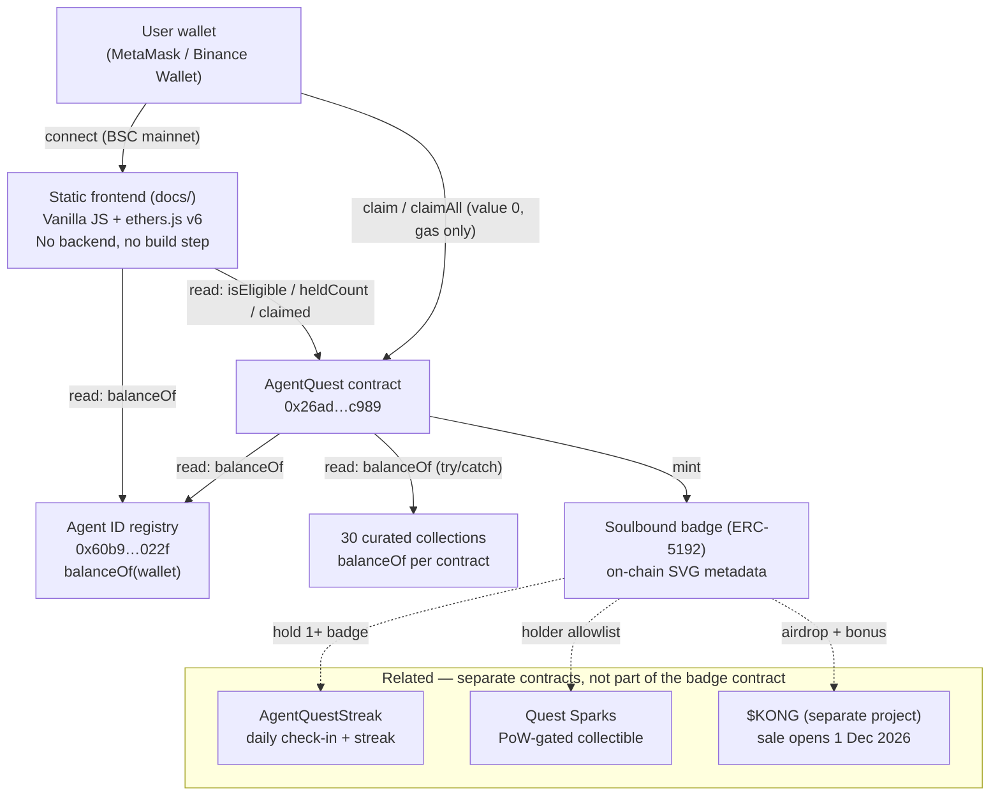

# AgentQuest

<p align="center"></p>

On-chain achievement badges for Binance Agent ID holders. Prove — purely
on-chain, with no server, no voucher, and no oracle — that you hold NFTs
across the Agent ID ecosystem, and claim soulbound badges for it.

Built for the **Binance Agent ID Hackathon** (Nov–Dec 2026).

- **Live app:** https://zainumq.github.io/agentquest/
- **Contract (BNB Chain):** [`0x26ad277193ff31bd086a47bf7b1d25a93573c989`](https://bscscan.com/address/0x26ad277193ff31bd086a47bf7b1d25a93573c989)
- **Source:** verified on [BscScan](https://bscscan.com/address/0x26ad277193ff31bd086a47bf7b1d25a93573c989#code) and [Sourcify](https://sourcify.dev/#/lookup/0x26ad277193ff31bd086a47bf7b1d25a93573c989) (exact match)
- **Status:** live on BNB Smart Chain mainnet since 18 Nov 2026 — live traction on the [status board](https://zainumq.github.io/agentquest/status.html).

## The problem

A Binance Agent ID proves you are an agent — but it says nothing about what
you have done. Today, an Agent ID holder's track record lives inside each
project separately: which collections you hold, which quests you finished,
how many days in a row you showed up. None of it is portable, none of it
can be verified by a third party without trusting that project's own
database, and none of it follows the holder to the next project. Reputation
does not travel.

## The solution

AgentQuest turns proven on-chain holdings into soulbound achievement badges.
A badge is minted only when the contract itself — reading the chain, with no
server, no voucher, no oracle, and no human in the loop — confirms the
holder qualifies: hold a Binance Agent ID, and hold NFTs from a curated list
of 30 Agent ID ecosystem collections. Badges are soulbound (ERC-5192), so
they cannot be transferred or sold; they stay bound to the wallet that
earned them. Claims are gas-only. There is no owner, no admin, and no
upgrade path — the quest rules are immutable.

On top of the badges, the site builds a reputation score (0–1,000, v2.1) from
the same on-chain facts — badges earned, check-in streaks, completed
campaigns, partner attestations, and verified contributions — so a reviewer
can read an agent's standing in seconds. The formula (v2.1, 27 Nov 2026):
Agent ID 100 · Badges 50 each (max 200) · Campaigns 30 per completed
campaign (max 300) · Consistency 3 per streak day (max 90) · Partner
Endorsement 20 per attestation received via AgentVouch (max 200) ·
Community Contributions 25 per verified contribution (max 100) · Quest
Sparks 10 flat for holding ≥1 (extras add 0). Quest Sparks are a
transferable collection — the 10 points come from ownership, so they could
be bought if a secondary market appears (none exists yet). Demo wallet
kingkoung.ai: 340/1,000 (Silver) = 100 + 200 + 0 + 30 + 0 + 0 + 10. See
[Try it](#try-it).

## Architecture



How to read it: the frontend only reads. The contract does the verifying:
it calls `balanceOf` on the Agent ID registry and on each curated
collection, counts distinct collections held (`heldCount`), and mints only
when the quest threshold is met. Everything under "Related" is a separate
contract (or a separate project, in the case of $KONG) that builds on badge
ownership — none of it is part of the badge contract, and none of it can
change how badges are earned.

## Contracts

| Contract | Address | Sourcify |
|---|---|---|
| AgentQuest Badge | [`0x26ad277193ff31bd086a47bf7b1d25a93573c989`](https://bscscan.com/address/0x26ad277193ff31bd086a47bf7b1d25a93573c989) | [exact match](https://sourcify.dev/#/lookup/0x26ad277193ff31bd086a47bf7b1d25a93573c989) |
| AgentQuestStreak | [`0xac9a16f991712aebe04b24e1a98e6b7c0d451afb`](https://bscscan.com/address/0xac9a16f991712aebe04b24e1a98e6b7c0d451afb) | [exact match](https://sourcify.dev/#/lookup/0xac9a16f991712aebe04b24e1a98e6b7c0d451afb) |
| Quest Sparks | [`0x20ef401acddb836e3576aade51f620f6a99631cb`](https://bscscan.com/address/0x20ef401acddb836e3576aade51f620f6a99631cb) | [exact match](https://sourcify.dev/#/lookup/0x20ef401acddb836e3576aade51f620f6a99631cb) |
| Agent ID registry (SPACE ID) | [`0x60b9262456de011f7d15a54cdd8c48baaa8b022f`](https://bscscan.com/address/0x60b9262456de011f7d15a54cdd8c48baaa8b022f) | [exact match](https://sourcify.dev/#/lookup/0x60b9262456de011f7d15a54cdd8c48baaa8b022f) |
| KongToken — related ($KONG) | [`0x410eAA536d701c5096619be8cBB6D46643796ee4`](https://bscscan.com/address/0x410eAA536d701c5096619be8cBB6D46643796ee4) | [exact match](https://sourcify.dev/#/lookup/0x410eAA536d701c5096619be8cBB6D46643796ee4) |
| KongSale — related ($KONG) | [`0x2F3728AABD454530302B9d2B66e9986f3ac1A3e3`](https://bscscan.com/address/0x2F3728AABD454530302B9d2B66e9986f3ac1A3e3) | [exact match](https://sourcify.dev/#/lookup/0x2F3728AABD454530302B9d2B66e9986f3ac1A3e3) |

Every address above links to BscScan, where the source is verified. All
verification statuses were checked 27 Nov 2026. $KONG is a separate project
by the same creator — see the [kong repo](https://github.com/zainumq/kong).
Note: KongMintPass and both KongVesting contracts are verified on Sourcify
as match (partial), not exact match.

## How it works

Any wallet holding a Binance Agent ID (`.ai`) can claim badges. Eligibility
is verified by the contract itself at claim time, by reading `balanceOf` on
the Agent ID registry and on a curated list of 30 Agent ID ecosystem NFT
collections. Claims are gas-only — there are no fees, no owner, no admin, and
no upgrade path. The quest list is immutable.

| Quest | Requirement |
|---|---|
| Agent ID Holder | Hold a Binance Agent ID |
| Collector I | Hold NFTs from ≥ 3 curated collections |
| Collector II | Hold NFTs from ≥ 10 curated collections |
| Collector III | Hold NFTs from ≥ 25 curated collections |

Badges are soulbound ERC-721 tokens (ERC-5192): permanently locked to the
wallet that earned them. Metadata is a fully on-chain SVG — no IPFS, no
server. One badge per quest per wallet; `claimAll()` claims every badge you
are eligible for in a single transaction.

See [CONTRACT.md](CONTRACT.md) for the full contract reference, the curated
list, test results, and gas numbers.

## Try it

### With a wallet

1. Open the [live app](https://zainumq.github.io/agentquest/).
2. Connect a wallet (MetaMask or Binance Wallet) on BNB Smart Chain mainnet.
3. The app checks your Agent ID status and eligibility off-chain first, so
   you never spend gas on a claim that would revert.
4. Claim a badge (or Claim All) and confirm the transaction in your wallet.
   Claims are gas-only, value 0 — one transaction per claim.
5. Optional: check in once a day from the home page. Check-in needs at
   least 1 badge plus an Agent ID, and builds your streak and reputation
   score.

Honest requirements: claiming needs a real Binance Agent ID **and** NFT
holdings in the curated collections (see the thresholds above). If you hold
neither, the page will show "not eligible" — that is the product working as
designed, not a bug.

### No wallet needed

Reviewers can inspect a real profile without connecting anything:

- **Demo profile:** kingkoung.ai — score 340/1,000 (Silver), 4 badges — live streak and score on the [profile](https://zainumq.github.io/agentquest/profile.html?wallet=0x0a90F878E4CF3EF3BC0Ee4a67e2FF0166986ad5F)
- Any wallet can be viewed the same way:
  `profile.html?wallet=<address>`

### Run locally

```bash
cd docs
python3 -m http.server 8080
# open http://localhost:8080
```

Any static file server works. Opening `index.html` directly with `file://`
will **not** work — ES modules and the CDN import need `http(s)://`.

## Proof: real claims

Every badge below was minted on BNB Smart Chain mainnet; each transaction
link goes to BscScan.

| Badge | Token | Minted | Transaction | Block |
|---|---|---|---|---|
| Collector II | #13 | 18 Nov 2026 | [`0x44847f36…e703`](https://bscscan.com/tx/0x44847f36611a463a94fdb707b3edfc7f72029a3d80030aec1cf435b1cee6e703) | 134329885 |
| Agent ID Holder | #23 | 18 Nov 2026 | [`0xa964df7a…e507`](https://bscscan.com/tx/0xa964df7aa4c805b5763eadf73ea377e4c2d8fd3ab04992dab0b8ac2095a0e507) (`claimAll`) | 134337360 |
| Collector I | #24 | 18 Nov 2026 | [`0xa964df7a…e507`](https://bscscan.com/tx/0xa964df7aa4c805b5763eadf73ea377e4c2d8fd3ab04992dab0b8ac2095a0e507) (`claimAll`) | 134337360 |
| Collector III | #25 | 18 Nov 2026 | [`0xa964df7a…e507`](https://bscscan.com/tx/0xa964df7aa4c805b5763eadf73ea377e4c2d8fd3ab04992dab0b8ac2095a0e507) (`claimAll`) | 134337360 |
| Quest Sparks (Rare) | #1 | 26 Nov 2026 | [`0x3b3f94e7…ccf45`](https://bscscan.com/tx/0x3b3f94e7e80e36716490ef7853f3913e64a7a687e8516efcdd53f0c734eccf45) | 135851000 |

The badge contract itself was deployed 18 Nov 2026 20:56 WIB —
[deploy tx `0x6e93e640…e9cf`](https://bscscan.com/tx/0x6e93e640c613c427143181e18da912683939cec9621b65dbc5031cae54c9e9cf)
(block 134323139).

**Traction:** live on the [status board](https://zainumq.github.io/agentquest/status.html) (badges and holders, read on-chain).

## How Binance Agent ID is integrated

- **Registry:** the SPACE ID Agent ID registry,
  [`0x60b9262456de011f7d15a54cdd8c48baaa8b022f`](https://bscscan.com/address/0x60b9262456de011f7d15a54cdd8c48baaa8b022f)
  on BNB Smart Chain mainnet. The registry address is passed to the
  constructor and stored `immutable` — the gate can never be re-pointed.
- **Gate on every claim:** the contract requires
  `balanceOf(holder) > 0` on the registry; claiming without an Agent ID
  reverts. The check happens on-chain at claim time, not in the frontend.
- **Holdings:** `heldCount(holder)` counts distinct curated collections
  with `balance > 0` (five tokens in one collection count as one).
- **Eligibility views:** `isEligible(questId, holder)` and
  `claimed(questId, holder)` are free view functions. The frontend reads
  both before sending anything — `isEligible` returns false for
  already-claimed quests, so `claimed()` is read separately to tell
  "claimed" from "not eligible".
- **Claims:** `claim(uint8 questId)` mints one badge;
  `claimAll()` mints every badge the caller is currently eligible for in a
  single transaction. Both are non-payable — attaching any value reverts.
- **Soulbound (ERC-5192):** `locked(tokenId)` is true for every badge;
  transfers, burns, and approvals all revert.
  `supportsInterface(0xb45a3c0e)` is `true` (verified on-chain, 27 Nov 2026).
- **No `totalSupply()`:** the registry does not implement it — calling it
  reverts. The contract never calls it; the Agent ID check is `balanceOf`
  only.
- **No off-chain trust:** no server, no oracle, no voucher, no signature.
  Quest config (registry address + the 30 curated contracts) is set once in
  the constructor and is immutable; the constructor rejects zero addresses,
  duplicates, and an empty list. There is no owner, admin, pause, upgrade,
  or withdraw function.
- **Curated list:** 30 contracts, derived 18 Nov 2026 and verified on-chain
  (`curatedLength()` = 30, all 30 addresses match). The full list is in
  [CONTRACT.md](CONTRACT.md).

## Development

Foundry project. Requires [Foundry](https://book.getfoundry.sh/).

```bash
forge install           # dependencies (OpenZeppelin, forge-std)
forge build
forge test            # 31 tests, incl. fuzz
```

- `src/AgentQuest.sol` — the contract
- `test/AgentQuest.t.sol` — tests + mocks
- `script/DeployAgentQuest.s.sol` — deployment script (already deployed)
- `flattened/` — the flattened single-file source as verified on BscScan,
  plus the ABI-encoded constructor arguments
- `docs/` — the static frontend (also served by GitHub Pages)

## License

MIT. See [LICENSE](LICENSE).
